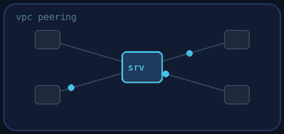
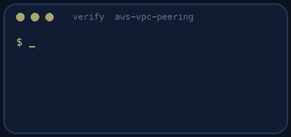
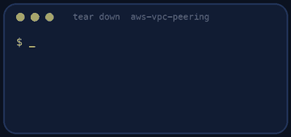

<p align="center"></p>

| | |
|-|-|
| **Time** | 60-75 min |
| **Cost** | a few cents (two small servers for an hour) |
| **You need** | An AWS administrator user (the IAM lab), the AWS CLI v2 configured for it, Python 3 and a terminal |

## How this lab works

1. **Fork** this repository to your own GitHub account (button at the top right).
2. Clone **your fork** in your Ubuntu environment (WSL on Windows, your OrbStack machine on Mac).
3. Read the lab below (the same text is in [`LAB.md`](LAB.md)) and follow the mission.
4. Answer the questions in [`SUBMISSION.md`](SUBMISSION.md). Where a question asks for output, paste it in a code block. No screenshots needed.
5. Commit and push. Open the **Actions** tab of your fork (click *I understand my workflows, go ahead and enable them* the first time). The **Lab check** shows what is still missing.
6. When the check is green, **submit the URL of your fork** in the course platform.

> [!NOTE]
> The check only looks at your answers and any files the lab asks you to commit. Your instructor reads your work and may ask you to explain any line.

<p align="center"></p>

## 🎬 The situation

<p align="center"></p>

Clippy's staging environment lives in its own VPC. The analytics team lives in another VPC, built by a different person for a different purpose. They have a deadline: the analytics server must call a staging service **privately**, over AWS's network, not over the internet. Nobody wants to expose staging to the world just so another team can read from it.

AWS has a tool for exactly this: **VPC peering**. It looks simple (a connection, a couple of routes) and it is famous for failing silently when you forget one of the pieces. You will build it, break it halfway and watch the failure, and complete it.

> [!IMPORTANT]
> **Your mission**
> - Look at two networks that cannot talk to each other
> - Create and accept a peering connection
> - Add the routes (both directions) and the one firewall rule that allows the call
> - Watch a server report, in its own tags, whether it can reach the other one
> - Tear everything down and prove it

**Time:** 60-75 min | **Cost:** a few cents (two small servers for an hour) | **You need:** an AWS administrator user, the AWS CLI v2 configured for it, Python 3 and a terminal.

<p align="center"></p>

## Part 0 - Set the scene

1. **Fork** this repository, clone it, and build the two networks:

```bash
./setup.sh
```

You get **staging** (`10.1.0.0/16`, a server at `10.1.1.10` that answers HTTP on port 80) and **analytics** (`10.2.0.0/16`, a server at `10.2.1.10`). The analytics server calls `http://10.1.1.10/` every 20 seconds and **writes the result on its own tags**: `peer-http` is `ok` or `fail`, and `peer-checked` is the time of the last try.

2. Watch the tag (give the server a minute or two to install its little script):

```bash
aws ec2 describe-instances --filters Name=tag:Name,Values=analytics-server Name=instance-state-name,Values=running \
  --query 'Reservations[0].Instances[0].Tags[?starts_with(Key,`peer`)].[Key,Value]' --output text
```

It says `fail`. Say why, before you touch anything: there are at least three reasons, in three different places.

> [!NOTE]
> **Think** Both servers have public IPs and sit in networks with an internet gateway. Why does the analytics server not simply call the staging server's public address? What is wrong with that when the security group is open to the internet?

<p align="center"></p>

## Part 1 - The peering connection

Create a peering connection **from the analytics VPC to the staging VPC** and **accept** it (you own both sides, so you accept your own request):

```bash
aws ec2 create-vpc-peering-connection --vpc-id <analytics vpc> --peer-vpc-id <staging vpc> --tag-specifications 'ResourceType=vpc-peering-connection,Tags=[{Key=lab,Value=aws-vpc-peering}]'
aws ec2 accept-vpc-peering-connection --vpc-peering-connection-id <pcx-...>
```

(Find the VPC ids with `aws ec2 describe-vpcs --filters Name=tag:lab,Values=aws-vpc-peering`.) Check its state: `pending-acceptance`, then `active`.

> [!NOTE]
> **Think** What would have happened if both networks used `10.0.0.0/16`? Why does peering refuse overlapping address ranges, and what would you do in a company that has already done it?

<p align="center"></p>

## Part 2 - The firewall, then one route

1. On the **staging** server's security group (`clippy-staging`), allow **TCP 80 from `10.2.0.0/16` only**. One rule, nothing else.
2. In the **analytics** route table add the route `10.1.0.0/16` through the peering connection. **Only that route.**

```bash
aws ec2 create-route --route-table-id <analytics rtb> --destination-cidr-block 10.1.0.0/16 --vpc-peering-connection-id <pcx-...>
```

Wait about a minute and read the tag again. It is **still `fail`**. The request now finds its way to staging, the firewall lets it in, the server answers... and the answer has no way back.

> [!NOTE]
> **Think** The reply goes to `10.2.1.10`. Look at the staging route table. What does the staging subnet do with a packet for `10.2.0.0/16`? This is the single most common peering mistake.

<p align="center"></p>

## Part 3 - The second route

Add the missing route in the **staging** route table: `10.2.0.0/16` through the same peering connection. Wait for the next check (20 seconds) and read the tag again: `peer-http` is `ok`.

> [!NOTE]
> **Think** Peering is **not transitive**: if A peers with B and B peers with C, A cannot reach C through B. For ten VPCs you would need 45 peering connections and 90 routes. What AWS service replaces this, and what does it cost?

<p align="center"></p>

## Part 4 - Prove it

<p align="center"></p>

```bash
./verify.sh
```

It reads the real peering connection (it must be active), both route tables, the staging security group (exactly one rule: TCP 80 from `10.2.0.0/16`) and the tag that the analytics server wrote about its own attempt. Fix what is red and run it again until it ends with **ALL CHECKS PASSED**.

> [!TIP]
> **Stuck?** The peering stays `pending-acceptance`: you created it but did not accept it. The tag stays `fail`: check the three things in order, peering active, a route in each VPC, and the security group on the staging server (source `10.2.0.0/16`). `InvalidParameterValue` creating a route: check the CIDR. The tag does not exist yet: the analytics server needs a minute or two after `setup.sh` to install its script.

<p align="center"></p>

## Level up (optional)

- Turn on **DNS resolution** for the peering connection and call the staging server by its private DNS name.
- Replace the CIDR in the firewall rule with the analytics server's **security group** (cross-VPC references work inside a region for peered VPCs). What is better and what is riskier?
- Draw what would change with an **AWS Transit Gateway** for three networks.
- Peer with a VPC in **another region** and compare the data-transfer prices.

<!-- teardown:start (generated by labs.py, do not edit) -->
## Tear down (mandatory)

<p align="center"></p>

Resources left behind cost money, keep doors open and pollute the next lab. Removing what you created is part of the job, so it is part of the submission: **you must prove it is gone**.

Do this **last**, after you have pasted your `verify` output into `SUBMISSION.md` (once you tear down, the lab can no longer be verified).

1. Run `./teardown.sh`. It deletes the peering connection, both VPCs, the servers and the role. Then run `./verify-teardown.sh`.

Then run the proof:

```bash
./verify-teardown.sh
```

It prints a list of checks and must end with **TEARDOWN VERIFIED**. If it reports leftovers, remove them and run it again. Paste the full output in your submission.
<!-- teardown:end -->

<!-- submission:start (generated by labs.py, do not edit) -->
## 📬 Submission

Answer the questions in `SUBMISSION.md` in **your fork** (paste output in code blocks where asked), push, then submit the **URL of your fork**.

**Files to commit**

- `notes.md` with your commands and what you saw (optional)

**Questions to answer**

1. Paste the peering connection (`aws ec2 describe-vpc-peering-connections`). Who is the requester and who accepts? What happens if the two VPCs have overlapping CIDR blocks?
2. Show the route tables on both sides. Why does peering need a route in each VPC? What would you see if you added only one?
3. Show the security group rule you added on the staging server. Why do you reference the other VPC's CIDR here and not a security group name? (Hint: cross-VPC references.)
4. Peering is not transitive. If VPC A peers with B and B peers with C, can A reach C? What would you use instead for ten VPCs?
5. Both servers report a result tag. Paste them before and after your fix and say what you changed first and what you found out second.
6. Paste the output of `./verify.sh`. It must end with **ALL CHECKS PASSED**.
7. **Tear down.** Paste the output of `./verify-teardown.sh`. It must end with **TEARDOWN VERIFIED**.
<!-- submission:end -->
